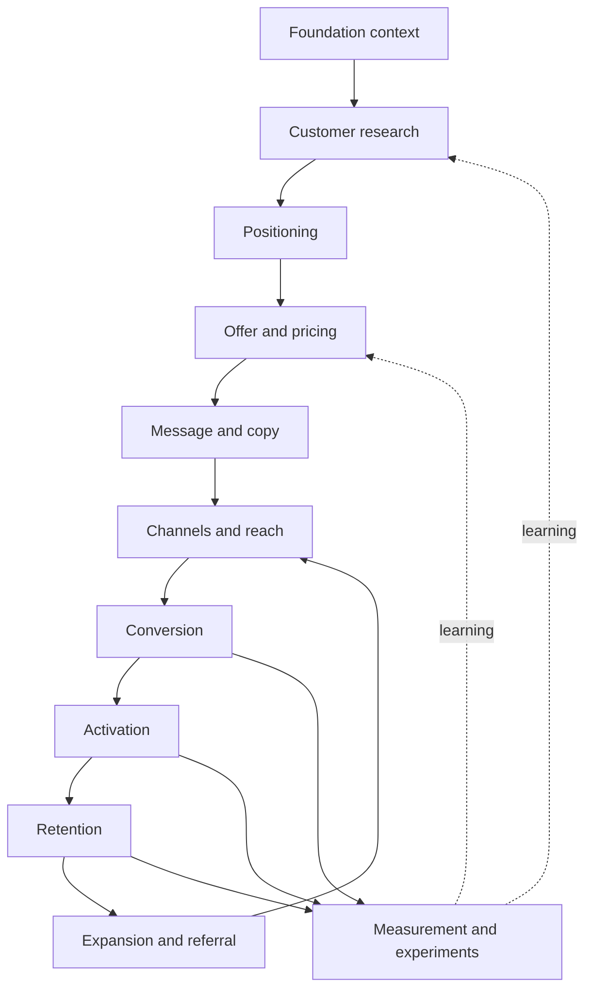

# The growth playbook

This playbook maps marketing, growth, and sales as one system. It tells you which stage to work on,
what each stage needs, what "done" looks like, and which Conquistador command or play does the work.

Use it in three ways:

1. **Find the constraint.** Read [the system map](#2-the-growth-system) and find the first stage
   that is not done. Work there. Effort on a later stage is mostly wasted until then.
2. **Plan a stage.** Each [stage guide](#3-stage-guides) gives the job, the steps, the traps, and
   the exit test.
3. **Pick a channel or a motion.** Use [the channel atlas](#4-channel-atlas) and
   [the motions by business model](#6-motions-by-business-model).

Limits. This is a map for people and for agents that read it on request. It is not a method that
Conquistador loads by default: default methods stay thin until a human blind test shows that a rule
improves the output. Numbers marked *(check)* are dated platform facts from October 2026. Confirm
them in the current specification before you rely on them. Nothing here replaces your own data.

## Contents

1. [Ten laws](#1-ten-laws)
2. [The growth system](#2-the-growth-system)
3. [Stage guides](#3-stage-guides)
4. [Channel atlas](#4-channel-atlas)
5. [Search and AI answers](#5-search-and-ai-answers)
6. [Motions by business model](#6-motions-by-business-model)
7. [Playbooks by company stage](#7-playbooks-by-company-stage)
8. [Sales](#8-sales)
9. [Measurement and experiments](#9-measurement-and-experiments)
10. [Writing that sounds like a person](#10-writing-that-sounds-like-a-person)
11. [Operating cadence](#11-operating-cadence)
12. [Trust, consent, and compliance](#12-trust-consent-and-compliance)
13. [Conquistador command map](#13-conquistador-command-map)

---

## 1. Ten laws

1. **Demand comes first.** Marketing finds people who already have a problem and serves them.
   It rarely creates a need. Test: people already spend time, money, or effort on the problem.
2. **Specific beats broad.** Write for one reader in one situation with one promise. A message
   for everyone persuades nobody.
3. **The offer does most of the work.** Audience and offer decide most of the result; the words
   decide the rest. Good copy cannot rescue an offer that nobody wants.
4. **Use the buyer's words.** Research comes before writing. The best headline is often a phrase
   that a customer said in an interview or a review.
5. **Proof must match the claim.** A small claim needs little proof. A large claim needs numbers,
   names, or a demonstration. Remove claims you cannot support.
6. **Distribution is a product decision.** Pick the channel that fits your price, your buyer, and
   how the buyer buys. One channel that works beats five that are half done.
7. **Owned assets compound; rented reach buys speed.** Search pages, an email list, a community,
   and a reputation grow over time. Ads and sponsorships stop when the money stops.
8. **Retention multiplies everything.** Acquisition into a leaking product burns money. Fix the
   leak before you increase the flow.
9. **Measure decisions, not dashboards.** Each metric must be able to change a decision. If no
   value of the number changes what you do, stop reporting it.
10. **Honesty is a growth strategy.** Fake scarcity, hidden terms, and dark patterns raise one
    number and damage trust, deliverability, and word of mouth. A person approves every send,
    publication, and payment.

---

## 2. The growth system

Each stage depends on the stages above it. When results are weak, look upstream first: a
conversion problem is often a positioning or an offer problem.

| Stage | Question it answers | Main output | Done when | Conquistador |
|---|---|---|---|---|
| Foundation context | What is true about the product and the business? | One product facts file | A new teammate can explain the product, buyer, price, and proof from it | `init` |
| Customer research | Who buys, why now, and in which words? | Language bank, triggers, objections, segments | You can quote real buyers for each claim | `position`, `diagnose` |
| Positioning | Why choose us over the real alternative? | Positioning statement and competitor view | Sales and marketing describe the product the same way | `position`, `brand` |
| Offer and pricing | What exactly does the buyer get, for what, with which risk? | Offer and price structure | Buyers understand the offer in one read and do not ask "how much?" | `pricing`, `decide` |
| Message and copy | What do we say, to whom, in what order? | Message hierarchy, pages, emails, posts | Each asset has one reader, one promise, proof, and one action | `copy`, `article`, `social`, `ads` |
| Channels and reach | Where do these buyers pay attention? | Channel plan with tests and kill rules | One channel produces a repeatable result | `channels`, `budget`, `plan`, `gtm` |
| Conversion | Do visitors take the next step? | Improved pages, forms, and flows | Conversion is measured per source, and the largest drop is known | `convert`, `funnel`, `landing` |
| Activation | Do new users reach the first real value? | Activation event and onboarding | Most new users reach the event quickly | `flow`, `lifecycle` |
| Retention | Do customers stay and keep using it? | Retention curves, churn program | Cohort curves flatten instead of falling to zero | `lifecycle`, `prioritize` |
| Expansion and referral | Do customers buy more and bring others? | Expansion paths, referral loop | A measurable share of new customers comes from existing ones | `referral`, `expand` |
| Measurement | What works, and what do we do next? | Tracking plan, reports, experiments | Each decision has a metric, and each test has a result | `measure`, `results`, `experiment`, `report` |

### Find the binding stage

Diagnose the funnel before you choose channels or tactics. Fix the first stage that fails:

| What you see | Work on |
|---|---|
| No users or no pipeline yet | Acquisition: find the first customers by hand |
| Users arrive but do not reach the first value | Activation |
| Users activate but leave | Retention |
| Users stay, but growth is slow | Referral, expansion, and pricing |
| The small funnel works end to end | Scale acquisition |

Once any users exist, fix leaks before you add traffic. A plan that spreads effort evenly over
every stage usually means the diagnosis is weak.

Two dependencies are hard. Tracking that you trust comes before paid spend, automation, or any
readout, because every later decision reads those numbers. A method runs by hand and proves useful
before it becomes a recurring, automated loop.

Later stages also feed earlier ones. Sales objections and the reasons you lose deals rewrite
positioning. Repeated pains from customer conversations rewrite the message. Each readout adds a
line to the product facts file under "what we learned".

---

## 3. Stage guides

Each guide has the same parts: the job, the steps, the traps, and the exit test.

### 3.1 Foundation context

**Job.** Write down what is true, once, so every later asset starts from facts instead of guesses.

**Steps.**
1. Record the product in plain words: what it does, for whom, and the problem it removes.
2. Record the buyer: role, company or life situation, the trigger that starts a search, and who
   else takes part in the decision.
3. Record the alternatives the buyer uses today, including "do nothing" and spreadsheets.
4. Record proof that you are allowed to use: numbers with their source and date, customer names
   with permission, reviews, awards, and certifications.
5. Record price, plans, terms, guarantee, and anything that the buyer must do to start.
6. Record the voice: words you use, words you avoid, and two or three samples that sound right.
7. Mark each fact as confirmed or open. Close the open ones before you publish claims that depend
   on them.

**Traps.** Writing aspirations as facts. Copying a competitor's claims. Proof without a date.

**Exit test.** A new teammate can answer "what, who, why us, how much, and what proves it" from
the file alone.

### 3.2 Customer research

**Job.** Learn why people buy, what almost stopped them, and the exact words they use.

**Steps.**
1. Talk to recent buyers first, then to people who chose a competitor or left. Recent memory is
   more accurate.
2. Ask about past behavior, not opinions. "Tell me about the day you started looking" gives
   better data than "Would you use a feature that ...?"
3. Rebuild the switch story: the trigger, the old way, what pulled them to something new, what
   made them anxious, and what habit almost kept them where they were.
4. Mine text that buyers already wrote: reviews of you and of competitors, support tickets, sales
   call notes, forum threads, and search queries.
5. Sort what you find into a language bank: pains, desired outcomes, triggers, objections, and
   exact phrases. Count how often each theme appears.
6. Group buyers into segments by situation and trigger, not by demographics alone.

**Traps.** Leading questions. Treating one loud customer as a segment. Surveys with only
multiple-choice answers, which return your words instead of theirs.

**Exit test.** For each main claim on your homepage, you can show a buyer quote that supports it.

### 3.3 Positioning

**Job.** Make the reason to choose you obvious in comparison with the real alternative.

**Steps.**
1. List the alternatives that buyers actually consider, from their research, not yours.
2. List what you have that those alternatives lack: capabilities, approach, data, or service.
3. Turn each difference into value for the buyer. A feature with no buyer value is not a
   difference.
4. Name the buyers who care most about that value. They are your best-fit segment.
5. Choose the frame that makes the value obvious: an existing category, a sub-category, or a new
   one. A new category costs years of education; use one only when no frame fits.
6. Profile each main competitor: who they serve, their promise, price, strengths, weak points from
   their own reviews, and how buyers describe them.
7. Write one positioning statement and test it in sales calls before you rewrite the website.

**Traps.** Claiming to be best at everything. Positioning against a competitor buyers never
consider. Changing positioning every quarter.

**Exit test.** Sales, the website, and customers describe the product and its difference in the
same way.

### 3.4 Offer and pricing

**Job.** Package the result so that saying yes is easy and the price feels fair.

**Offer parts.** An offer is more than a product and a price:

| Part | Question |
|---|---|
| Outcome | What changes for the buyer, and by when? |
| Mechanism | Why will it work this time? |
| Proof | Why should the buyer believe it? |
| Effort | What must the buyer do, and how long until the first result? |
| Risk reversal | What happens if it does not work? Trial, guarantee, or cancellation terms. |
| Price and terms | What does it cost, how is it billed, and what is included? |
| Reason to act now | A real deadline, a real capacity limit, or a real price change. Never an invented one. |

**Pricing steps.**
1. Choose a value metric that grows with the value the customer gets: seats, usage, records, or
   revenue processed. A good metric is easy to predict and easy to understand.
2. Build two to four tiers for clear segments. Each tier has a name that tells the buyer who it is
   for. Put the features that matter to larger buyers in higher tiers.
3. Anchor with the tier you expect most buyers to choose, and show the value of the higher tiers.
4. Decide between free plan, free trial, and paid only. A free plan suits products that spread
   through use; a trial suits products whose value appears in days; paid only suits high-touch
   sales.
5. Research willingness to pay before you test prices in public. Ask buyers which price is too
   cheap to trust, a bargain, getting expensive, and too expensive.
6. Raise prices for new customers first. Give existing customers notice and a reason.

**Traps.** Pricing from cost. Too many tiers. Discounts that train buyers to wait. A pricing page
that hides the price.

**Exit test.** A buyer can choose a plan without a call, or knows exactly why a call is needed.

### 3.5 Message and copy

**Job.** Say the right thing to the right reader at their level of awareness.

**Awareness ladder.** The reader's knowledge decides the opening:

| Reader knows | Open with |
|---|---|
| Nothing about the problem | A situation they recognize |
| The problem, not the solutions | The cost of the problem, made concrete |
| Solutions, not your product | Why your approach fits them better |
| Your product, but is not convinced | Proof and answers to objections |
| Your product and wants it | The offer and the easiest next step |

**Message hierarchy.** Every page or email needs, in order: one promise, the reasons to believe
it, proof, answers to the main objections, and one clear action. Supporting detail goes below.

**Page skeleton (for a page that sells).** Headline with the promise. A line that says who it is
for and how it works. The action. Proof near the top. The problem in the buyer's words. How it
works in three steps or fewer. Benefits tied to features. Objections answered. The offer and risk
reversal. The action again.

**Traps.** Clever headlines that hide the promise. Feature lists without the result. Several
calls to action that compete. Proof placed only at the bottom.

**Exit test.** A stranger can say, after five seconds, what it is, who it is for, and what to do
next.

### 3.6 Channels and reach

**Job.** Find the one channel that reaches enough of your buyers at a cost the business can carry.

**Steps.**
1. List every plausible channel. Use [the channel atlas](#4-channel-atlas).
2. Remove channels that do not fit your economics. A low-price product cannot pay for a sales
   team; a high-price product can rarely sell through impulse ads.
3. Rank the rest by three questions: are my buyers there in numbers, can I reach them at a cost I
   can carry, and does it compound?
4. Run cheap tests on the top two or three. Set the budget, the time box, the success number, and
   the kill rule before you start.
5. Put most effort into the one channel that passes. Keep a small budget for the next test.
6. Revisit when the channel saturates: when costs rise or results fall for several weeks.

**Traps.** Spreading effort over many channels. Judging a compounding channel such as search
after three weeks. Copying the channel of a company with a different price or buyer.

**Exit test.** One channel produces customers at a repeatable cost, and you know what limits it.

### 3.7 Conversion

**Job.** Remove what stops interested people from taking the next step.

**Diagnose in this order.**
1. **Relevance.** Does the page match the promise of the link, ad, or search that sent the
   visitor? A mismatch is the most common and cheapest problem to fix.
2. **Clarity.** Can the visitor say what it is and why it matters within five seconds?
3. **Motivation.** Is there enough proof and value for the size of the ask?
4. **Friction.** Fields, steps, loading time, forced account creation, and surprises in price.
5. **Anxiety.** Missing security signals, unclear terms, or no way to undo.
6. **Distraction.** Navigation, offers, and links that compete with the main action.

**By surface.**
- **Forms.** Ask only for what the next step needs. Each extra field must earn its place.
- **Signup.** Let people start before they commit details. Social sign-in and short forms help.
  Show what happens after signup.
- **Pricing page.** Show prices. Mark the recommended plan. Answer billing questions on the page.
- **Popups.** Time them to intent: after real engagement or on exit, not on arrival. Cap how often
  a person sees one. Make closing easy.
- **Paywalls and upgrade prompts.** Show them at the moment the user hits a limit while getting
  value, not at random. Say what the upgrade unlocks in the user's current task.

**Traps.** Testing button colors before the offer is clear. Copying a competitor's page.
Declaring a winner on a small sample.

**Exit test.** You know conversion by traffic source and the largest drop-off, and each change is
tied to a measured result.

### 3.8 Activation

**Job.** Get new users to their first real value quickly, because that predicts whether they stay.

**Steps.**
1. Define the activation event: the action that best separates users who stay from users who
   leave. Find it in your data; do not guess.
2. Measure time to that event and the share of new users who reach it.
3. Remove every step before the event that is not needed. Delay settings, invitations, and
   profile details until after the first value.
4. Use empty states that show the next action, sample data, and templates.
5. Send onboarding messages based on behavior: help the users who stalled, not the ones who
   succeeded.

**Traps.** Product tours that show every feature. Measuring signups instead of activated users.

**Exit test.** The activation rate rises, and activated users retain better than the others.

### 3.9 Retention

**Job.** Keep customers getting value, and stop avoidable losses.

**Steps.**
1. Plot retention by signup cohort. A healthy curve flattens; a curve that falls to zero means the
   product does not yet fit this segment.
2. Separate churn into two kinds. **Voluntary**: the customer decides to leave. **Involuntary**: a
   payment fails. They need different fixes.
3. For voluntary churn, build a cancellation flow: ask the reason, then show one response that
   matches it. Too expensive: a downgrade or a pause. Not using it: help or a pause. Missing a
   feature: the roadmap or a workaround. Always let the customer finish cancelling.
4. For involuntary churn, set up payment recovery: warn before a card expires, retry failed
   payments on a schedule, ask the customer to update the card by email and in the product, and
   use the payment processor's card updater. Retry only temporary declines. Do not retry a card
   reported lost or stolen, and send an authentication failure to the customer. Card networks
   limit how often a merchant may retry one transaction *(check)*.
5. Watch health signals: falling usage, fewer active seats, support complaints, and the loss of a
   champion. Act before the renewal date.
6. Win back former customers when something they missed has changed.

**Traps.** Cancellation flows that trap people. Discounts offered to everyone. Treating all churn
as one number.

**Cancellation law.** A US appeals court vacated the federal "click-to-cancel" rule in July 2025.
State automatic-renewal laws and other consumer protection laws still apply *(check)*. Make
cancellation as easy as signup anyway; a hard exit produces chargebacks and bad reviews.

**Exit test.** Cohort curves flatten, and you know the top three reasons customers leave.

### 3.10 Expansion and referral

**Job.** Grow revenue from existing customers and turn them into a source of new ones.

**Expansion.** Map the paths: more seats, more usage, a higher tier, or add-ons. Prompt the
expansion when the customer approaches a limit or a new need appears, not on a sales calendar.

**Referral.** Ask after the customer gets value, not at signup. Make sharing one step. Reward both
people when the reward fits the product. Track invitations sent, accepted, and converted.

**Loops instead of funnels.** A loop turns the output of one user into the input for the next:
content that a user creates and shares, an invitation needed to collaborate, or a public page
that ranks in search. Loops compound; funnels need new input every time.

**Traps.** Rewards larger than the value of a customer. A referral program for a product that
people do not talk about.

**Exit test.** A known share of new customers comes from existing ones, and net revenue retention
is measured.

### 3.11 Measurement and experiments

See [section 9](#9-measurement-and-experiments).

---

## 4. Channel atlas

Use this table to choose what to test first. "Time to signal" is how long a fair test takes.

| Channel | Fits when | Time to signal | Compounds | Cheap first test | Stop when |
|---|---|---|---|---|---|
| Search (SEO) | Buyers search for the problem or the category | 3–6 months | Yes | 10 pages for high-intent queries you can win | Pages are indexed, but impressions do not grow after 4–6 months |
| AI answers | Buyers ask assistants for recommendations or comparisons | 1–3 months | Yes | Make 5 key pages easy to quote; check citations for 20 buyer questions | Never; treat it as part of search |
| Programmatic pages | You own data that answers many similar queries | 2–4 months | Yes | 50 pages from one template with unique data | Pages are crawled but not indexed, or they get no clicks |
| Content and newsletter | The buyer researches before buying, and you have expertise | 3–6 months | Yes | 8 pieces for one audience, one topic | No subscriber growth or replies after 3 months |
| Founder-led social | The founder has a point of view and buyers follow people in this space | 1–3 months | Yes | 30 posts in 6 weeks | No conversations, follows, or demo requests after 6 weeks |
| Communities | Buyers gather in forums or groups and value help | 1–2 months | Partly | Answer questions for 4 weeks, without links | Rules forbid any promotion, or members are not buyers |
| Public relations | You have news, data, or a story that a journalist's readers want | 1–3 months | Partly | One data story pitched to 20 relevant writers | No responses after two well-targeted rounds |
| Podcasts and guest spots | Hosts with your audience need guests | 1–2 months | Partly | 5 appearances | No traffic, mentions, or leads after 5 |
| Events and webinars | Deal size supports time with people; buyers attend events | 1–3 months | No | One webinar with a partner | Cost per qualified lead stays above other channels |
| Paid search | People search with buying intent | 2–4 weeks | No | Exact-match ads for 5–10 buying queries | Cost per customer stays above the margin you can pay |
| Paid social | The product is visual, impulse-friendly, or targets clear interests | 2–4 weeks | No | 3 concepts, 3 variations each, small daily budget | No concept reaches target cost after creative changes |
| Professional network ads | Buyers are defined by job title and company | 3–6 weeks | No | One offer to one tightly defined audience | Cost per qualified lead stays too high for deal size |
| Creators and influencers | Audiences trust creators in your category | 2–6 weeks | Partly | 3–5 small creators with clear disclosure | No tracked signups after a full posting cycle |
| Affiliates and partners | Others already serve your buyer and can recommend you | 1–3 months | Yes | 5 partners with a clear commission | Partners do not activate after onboarding |
| Co-marketing | A non-competing company shares your buyer | 1–2 months | Partly | One joint asset or webinar | Joint leads do not convert |
| Cold outbound | Deal size supports sales effort, and buyers are identifiable | 2–4 weeks | No | 200 well-chosen accounts, short relevant emails | Replies stay below about 1–2% after message changes |
| Directories and launch sites | Buyers browse lists of tools in your category | Days to weeks | Partly | List on the 5 most relevant directories | No referral traffic or reviews after a month |
| App stores | You have a mobile app | 2–6 weeks | Yes | Rewrite the title, subtitle, and screenshots | Store conversion does not change after two tests |
| Free tools | A small useful tool solves a sub-problem of your buyer | 1–4 months | Yes | One calculator or checker on a page that can rank | No organic traffic or signups from the tool after 3 months |
| Product loops | Using the product exposes it to new people | Ongoing | Yes | Add one sharing or invitation moment at the point of value | No measurable invitations after the change |
| Email and SMS lifecycle | You have an audience that agreed to hear from you | 2–4 weeks | Yes | A welcome sequence and one behavior-based message | Unsubscribe or complaint rates rise above healthy limits |

---

## 5. Search and AI answers

### Start from your own data

Your search console data shows what search engines actually show and what people actually click.
Keyword tools estimate from samples and often disagree with each other. Use your own data for
decisions about pages you already have. Use estimates only for new topics, and label them as
estimates.

### Six diagnostics that find most opportunities

| Diagnostic | What to look for | Usual fix |
|---|---|---|
| Near page one | Queries where a page ranks just below the top results and has steady impressions | Improve that page for that query: answer it directly, add depth, add internal links |
| Low click-through | Pages whose click rate is well below your own site's normal rate for that position | Rewrite the title and description to match the searcher's intent |
| Decay | Pages whose clicks fell between two equal time windows | Update facts, add what is missing, merge thin pages |
| Cannibalization | Two or more of your pages split impressions for the same query | Choose one page, merge or redirect the others, and fix internal links |
| Coverage gaps | Queries a page appears for but never mentions | Add a section that answers them, or create a separate page |
| Sudden change | A drop or rise that starts on a known search update date | Compare the weeks before and after; look for a pattern across page types |

Compare your click rate to your own site's curve by position, not to an industry average. Ignore
queries with very few impressions; they are noise.

**Starting thresholds.** These are working defaults for a first triage, not rules from a search
engine. Tune them to your site.

- **Bands by average position.** Positions 1–3 with a click rate well below your own curve (for
  example below 60% of it): rewrite the title and description. Positions 4–10 below the curve:
  quick wins. Positions 11–20: the page-two list, ranked by impressions weighted by how close the
  page is to position 10.
- **Expected click rate.** Build your own curve from the typical click rate of your pages at each
  position. Use it only when you have enough data, for example at least 1,000 impressions spread
  over several pages. Fall back to a generic curve until then.
- **Noise floor.** Scale the minimum impressions per query with the size of the site. A small site
  might use 10; a large one 100 or more.
- **Decay.** Flag a page when clicks fall by 20% or more between two equal windows. Then find the
  cause: position lost (more than one place worse), click rate lost (impressions held but clicks
  fell), or demand lost (impressions fell).
- **Cannibalization.** Flag a query when two or more of your pages each take a real share of its
  impressions (for example 10% or more), and no single page holds most of it.
- **Sudden change.** Look for a step change that lasts, not a single bad day. Compare weekly
  medians, and check whether the date falls within a few days of a known search update.
- **Indexing limits.** Search Console keeps 16 months of performance data *(check)*. Export it on a
  schedule if you need longer history.

### Technical health

Pages must be crawlable, indexable, canonical, and fast. Check index coverage first: a page that
is not indexed cannot rank. Then check speed and stability. The current "good" thresholds for
Core Web Vitals are a Largest Contentful Paint of 2.5 seconds or less, an Interaction to Next Paint
of 200 milliseconds or less, and a Cumulative Layout Shift of 0.1 or less, measured at the 75th
percentile of real users *(check)*.

### AI answers

AI assistants answer from pages they can fetch and from what other sites say about you.

1. **Access.** Each assistant uses separate crawlers for training, search, and user-requested
   fetches. Decide each one deliberately in `robots.txt`. Blocking a search crawler removes you
   from that assistant's answers.
2. **Quotable pages.** Put the direct answer first. Use clear definitions, comparison tables,
   numbered steps, and specific numbers with sources. Keep one topic per page.
3. **Consistency.** Describe the product, category, and price the same way on your site, in
   directories, and in profiles. Inconsistent facts produce inconsistent answers.
4. **Mentions.** Assistants repeat what reviews, comparisons, forums, and articles say. Earn
   mentions on the pages that rank for your buyers' questions.
5. **Measurement.** Track referral traffic from assistants and check, on a schedule, how
   assistants answer a fixed list of buyer questions.

### Pages at scale

Build many pages from a template only when you have unique data for each page and the template
answers the query better than a single page could. Pages that differ only by a swapped keyword
are thin, and search engines treat them as low value.

---

## 6. Motions by business model

| Model | Usual primary motion | Key metric | First channels | Common mistake |
|---|---|---|---|---|
| B2B SaaS, low price, self-serve | Product-led | Activation rate, trial-to-paid | Search, content, product loops, directories | Adding sales before self-serve conversion works |
| B2B SaaS, high price | Sales-led | Pipeline created, win rate, cycle length | Outbound, events, partners, content for buying committees | Sending inbound leads to sales without qualification |
| Developer tools | Community and product-led | Weekly active projects, conversion to team plans | Documentation, open source, technical content, communities | Marketing language that developers distrust |
| Consumer subscription app | Paid social and store | Day-1/7/30 retention, trial-to-paid | App store, creators, paid social, referral | Scaling ads before retention is stable |
| E-commerce and direct to consumer | Paid social, creators, lifecycle | Contribution margin, repeat purchase rate | Paid social, creators, email and SMS, marketplaces | Judging ads on first-order revenue only |
| Marketplace | Supply first, then demand | Liquidity: share of listings or requests matched | One niche or city at a time, search, community | Launching wide before one segment works |
| Services and agencies | Referral and authority | Pipeline from referrals, close rate | Founder content, partners, case studies, outbound | Selling hours instead of a clear outcome |
| Local business | Local search and reviews | Calls, bookings, reviews | Map listings, reviews, local partnerships | Ignoring reviews and listing accuracy |

---

## 7. Playbooks by company stage

### Zero to first ten customers

Sell by hand. The founder talks to every buyer. Do things that do not scale: personal outreach,
custom onboarding, and fixes shipped the same day. The goal is to learn who buys and why, not to
build a channel. Write down every objection.

### Ten to one hundred customers

Find one repeatable channel. Turn what the founder said in sales calls into the website, emails,
and a short sales process. Define the activation event. Start the product facts file and the
language bank if they do not exist.

### One hundred customers and beyond

Build systems. Add a second channel only when the first one is running reliably. Hire for the
channel that works. Put tracking, lifecycle messages, and a regular experiment cadence in place.
Watch retention by cohort as you grow, because new segments often retain worse than early ones.

---

## 8. Sales

### Find the right accounts

1. Define the ideal customer by fit (industry, size, tools, situation) and by timing signals
   (hiring, funding, a new leader, a tool change, a public complaint).
2. Rank signals by strength: what a person said or did is stronger than a company event, and a
   company event is stronger than a segment fact.
3. Build small, accurate lists. Two hundred good accounts beat two thousand loose ones.

### Reach out

Write one short, relevant message with one ask. The reason for writing must come from the buyer's
situation, not from a copied profile detail. Follow up a few times, each time with something new.
Stop when the buyer says no.

### Run the conversation

| Step | Goal | Key move |
|---|---|---|
| Discovery | Understand the situation, the pain, its cost, and how the decision is made | Ask about the last time the problem happened and what it cost |
| Demo | Show the path from their pain to their result | Show only what relates to what they said in discovery |
| Objections | Remove the doubts that block the decision | Ask what is behind the concern, answer with proof, and confirm it is resolved |
| Proposal | Make the decision easy to approve | Restate their goals, the plan, the price, and the next steps |
| Close | Agree on the steps to a decision | Write a shared plan with dates and owners on both sides |

### Sales assets

A short one-pager, a case study per main segment, competitor comparison notes for the sales team,
an objection guide, a demo script, and a value calculator. Build each from real call notes, not
from marketing copy.

### Revenue operations

Define lifecycle stages with clear entry rules (subscriber, lead, qualified lead, opportunity,
customer). Score leads by fit and by intent separately. Route qualified leads to a person within
a set time. Measure conversion and time between stages. Keep the CRM clean: one owner per record
and required fields at each stage.

---

## 9. Measurement and experiments

### Metrics

Choose one north star metric that reflects value delivered to customers, such as weekly active
teams or orders delivered. Under it, track the few input metrics you can influence: new activated
users, retention by cohort, and revenue per customer. Report each one with its trend and its
target.

### Unit economics

| Metric | Meaning | Healthy direction |
|---|---|---|
| Customer acquisition cost | Sales and marketing cost per new customer | Lower, or stable while volume grows |
| Payback period | Months of gross margin needed to recover acquisition cost | Shorter |
| Lifetime value | Gross margin a customer produces over their life | Higher than acquisition cost by a wide margin |
| Net revenue retention | Revenue from a cohort a year later, including expansion and churn | Above 100% means the base grows by itself |

### Tracking

Write a tracking plan before you add tags: the events, their properties, their names, and the
decision each one supports. Use one naming pattern, such as object and action. Track conversions
on the server when browsers block scripts. Test every event after each release.

Count a conversion only on confirmed success, such as the thank-you state or the server response,
not on a button click. Then verify that each conversion actually arrives in each ad platform and
in your CRM. Never add up conversions that different platforms report: each one claims credit for
the same customer.

### Attribution

No attribution model is the truth. Platform reports overcount their own results. Combine three
views: what your analytics tool shows, what customers say when you ask "how did you hear about
us?", and what changes when you turn a channel off or on (incrementality). Make decisions on the
direction that the views agree on.

### Experiments

1. Write the hypothesis: the change, the expected effect, and the reason.
2. Choose one primary metric and a few guardrail metrics that must not get worse.
3. Calculate the sample size for the smallest effect worth detecting before you start. For
   example, to detect a lift from 5% to 6% conversion (a 20% relative lift) with the usual 95%
   confidence and 80% power, you need about 8,200 visitors in each variant.
4. Run for full weeks to cover weekday and weekend behavior. Do not stop early because a result
   looks good.
5. Record the result, including failed tests. A failed test that you recorded is still learning.
6. Prioritize the backlog by expected impact, confidence, and effort.

Low traffic changes the method. When a test would take months, make larger changes, test on the
step with the most traffic, or use qualitative research instead.

---

## 10. Writing that sounds like a person

Readers trust writing that sounds like one person who knows the subject. Writing that sounds
generated loses that trust in one line.

**Do.**
- Be specific: a number, a name, a time, a place. "Saves time" says nothing; "Cuts invoice review
  from two days to two hours" says something.
- Use the reader's words from research.
- Make one point per sentence and one idea per paragraph.
- Use plain verbs. Prefer "use" to "leverage" and "help" to "empower".
- Let the voice have edges: an opinion, a short sentence, a plain admission of a limit.
- Cut warm-up sentences. Start with the point.

**Avoid.**
- Inflated verbs and adjectives: unlock, elevate, seamless, robust, cutting-edge, game-changing.
- Stock openers and closers: "In today's fast-paced world", "Let's dive in", "In conclusion".
- The "not just X, it's Y" frame and rhetorical contrasts used as decoration.
- Lists of three by reflex, and every paragraph the same length.
- Hedges stacked on each other: "may potentially help to somewhat improve".
- Claims with no proof, and urgency with no real deadline.

Run `conquistador check <file>` to flag many of these patterns automatically. A human read is still
the final test: read the text aloud and ask whether a person would say it.

---

## 11. Operating cadence

| Rhythm | Work |
|---|---|
| Weekly | Review the input metrics. Ship planned assets. Start or end experiments. Read new customer feedback. |
| Monthly | Review channel results against the kill rules. Update the experiment backlog. Review retention by cohort. |
| Quarterly | Review positioning and pricing against what you learned. Choose next quarter's bets. Retire what failed. |
| After each launch or campaign | Write a short review: the goal, the result, what to repeat, and what to stop. |

Keep one experiment log and one product facts file. Everything else can change.

### Recurring loops

Automate a routine only after you ran it by hand and it proved useful. Start with the loops that
protect revenue (failed payments, churn signals, broken tracking), then the ones that fix
activation and conversion, then the ones that grow the top of the funnel. Each loop needs:

- a schedule and a condition that triggers action;
- a self-check that the data it reads is current;
- a record of what it did last time;
- a stop rule;
- a person who approves every send, publication, and spend.

---

## 12. Trust, consent, and compliance

Follow the law in each market where you sell. The points below are common requirements, not legal
advice; check them before use.

- **Email.** Large mailbox providers require bulk senders to authenticate mail (SPF, DKIM, and a
  DMARC policy), to offer one-click unsubscribe, to honor unsubscribes quickly, and to keep spam
  complaint rates low *(check)*. Send marketing email only to people who agreed to receive it
  where the law requires consent.
- **Email at volume.** Since February 2024, the largest mailbox providers require senders of about
  5,000 or more messages a day to authenticate with SPF, DKIM, and DMARC, to support one-click
  unsubscribe and process it within two days, and to keep the reported spam rate below 0.3% *(check)*.
- **SMS and messaging.** In the US, marketing texts need prior express written consent, and words
  such as "stop" must end messages within 10 business days at most. Send between 8 a.m. and
  9 p.m. in the recipient's time zone; some states end at 8 p.m. Register 10-digit sender numbers
  before you send. WhatsApp marketing templates do not reach US numbers *(check)*.
- **Reviews.** Do not ask only happy customers for reviews. Some review sites forbid incentives;
  others allow only small, disclosed ones *(check)*.
- **Endorsements.** Disclose paid relationships with creators, affiliates, and reviewers clearly
  and close to the claim.
- **Claims.** Have evidence for performance claims before you publish them. Price comparisons must
  be true and current.
- **Privacy.** Ask for consent before tracking where the law requires it. Collect only the data
  you use.
- **Dark patterns.** Do not hide the cancel path, pre-check paid add-ons, or invent countdowns.

### When something goes wrong

For an outage, a breach, or a public mistake: confirm the facts first, and bring in legal counsel
when people's data or money is involved. Name one spokesperson. Publish a short holding statement
that says what you know, what you are doing, and when the next update comes, without guessing at
the cause. Tell the people affected first, then staff, then your status page and channels, then
the press. Apologize without "but". Publish what you changed afterward.

---

## 13. Conquistador command map

| You want to | Use |
|---|---|
| Record product facts once | `init` |
| Decide positioning or brand | `position`, `brand` |
| Set prices and packaging | `pricing` |
| Make a hard choice between options | `decide`, `prioritize` |
| Plan go-to-market or a quarter | `gtm`, `plan` |
| Choose channels and budget | `channels`, `budget` |
| Plan a campaign, launch, or event | `campaign`, `launch`, `event` |
| Write pages, emails, posts, or ads | `copy`, `landing`, `social`, `ads`, `article` |
| Write sales outreach | `outreach`, `outbound` |
| Improve conversion on a page or flow | `convert`, `funnel`, `flow` |
| Build onboarding, retention, or win-back messages | `lifecycle` |
| Grow through referrals or expansion | `referral`, `expand` |
| Improve search, AI answers, or store listings | `seo`, `answers`, `pseo`, `appstore` |
| Get press | `press` |
| Make videos and creative assets | `video`, `trailer`, `creative`, `series` |
| Set up tracking and read results | `measure`, `results`, `report`, `watch` |
| Find why a number moved | `diagnose` |
| Run a test | `experiment` |
| Review a draft | `check`, `critique`, `factcheck`, `review`, `audit` |

Type `/conquistador <command>` or describe the task in your own words.
